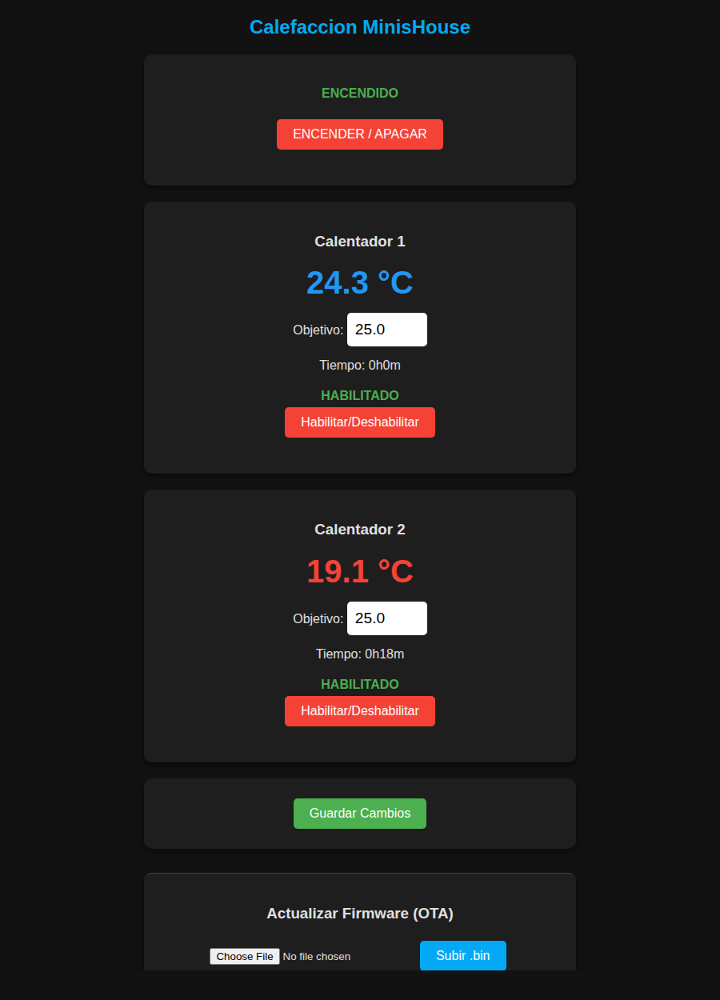

# MinisHouse 🐱

Firmware de control de calefacción para una **mini casa para gatos**: dos zonas independientes, cada una con su calentador de bajo voltaje y su sonda de temperatura, panel OLED, interfaz web y actualización OTA.

## Objetivo

- Mantener cada zona en su temperatura objetivo mediante histéresis (±1 °C).
- Uso de almohadillas calefactables para mascotas de bajo voltafe (15v-20V)
- Encendido/apagado global y habilitación independiente de cada calentador, con estado persistente.
- Mostrar temperaturas, estado y potencia en una pantalla OLED SSD1306 de 128x64 (opcional).
- Configuración y monitorización desde un navegador Web por WiFi.
- Avisar si un calentador lleva más de 30 minutos funcionando de forma continua.
- Control de presencia gatuna (opcional)
- Actualizar el firmware por OTA desde la propia interfaz web.

## Arquitectura hardware

MCU **ESP32-C3** sobre PCB propia MinisHouseStd. Esquemático y PCB en [`hw/`](hw/).

| Función | GPIO | Notas |
|---|---|---|
| LED de estado | 10 | |
| Bus OneWire (DS18B20) | 4 | Dos sondas, una por zona |
| Calentador 1 (MOSFET) | 3 | Bajo voltaje (15–20 V); PWM LEDC a 1 kHz, 8 bits |
| Calentador 2 (MOSFET) | 2 | Bajo voltaje (15–20 V); PWM LEDC a 1 kHz, 8 bits |
| Presencia 1 | 6 | Entrada con pull-up, activa a nivel bajo |
| Presencia 2 | 7 | Entrada con pull-up, activa a nivel bajo |
| OLED SSD1306 | I2C | 128x64, dirección 0x3C; SDA/SCL en GPIO8/GPIO9 |

La etapa de potencia conmuta cada calentador mediante un MOSFET cuyo gate se controla por PWM. Los calefactores trabajan a **bajo voltaje (15–20 V)**, evitando tener tensiones de 230 VAC cerca de los gatos. 

## Arquitectura software

- **PlatformIO + Arduino-ESP32 3.3.12 / ESP-IDF 5.5.5** (plataforma [pioarduino](https://github.com/pioarduino/platform-espressif32)).
- Todo el firmware está en `src/main.cpp`. Librerías: WiFi/WebServer, Update (OTA), Preferences (NVS), OneWire + DallasTemperature, Adafruit GFX + SSD1306.
- `loop()` no bloqueante: lectura asíncrona de las DS18B20 cada 1 s, control de histéresis y PWM, refresco de la OLED cada 500 ms y atención del servidor web.
- **Control**: si la temperatura baja de `objetivo - 1 °C` enciende; si sube de `objetivo + 1 °C` apaga. PWM configurado a 1 kHz/8 bits, usado actualmente como todo/nada (0/255).
- **Persistencia (NVS)**: temperaturas objetivo, estado global del sistema y habilitación de cada calentador.
- **Control de presencia**:El icono 🐱 de la web indica presencia detectada junto a cada calentador (opcional).
- **Seguridad**: se descartan lecturas de -127 °C (sonda desconectada); aviso visible en la web tras 30 min de calentamiento continuo (no corta la calefacción automáticamente).

### API web

| Ruta | Método | Función |
|---|---|---|
| `/` | GET | Panel de control |
| `/status` | GET | Estado en JSON (incluye versión `fw`, temperaturas, tiempos y avisos) |
| `/set?t1=&t2=` | GET | Fijar temperaturas objetivo |
| `/toggle` | GET | Encender/apagar el sistema |
| `/toggleHeater1`, `/toggleHeater2` | GET | Habilitar/deshabilitar cada calentador |
| `/update` | POST | Actualización OTA (campo `update`) |

## Compilación y uso

1. Copiar `src/secrets.example.h` a `src/secrets.h` y rellenar SSID y contraseña WiFi (este archivo no se versiona).
2. Compilar con `pio run` y grabar por USB con `pio run -t upload`.
3. OTA: subir el `.bin` desde `http://<ip>/` o con `curl -F "update=@firmware.bin" http://<ip>/update`.
4. Monitor serie a 115200 baudios con `pio device monitor`.
